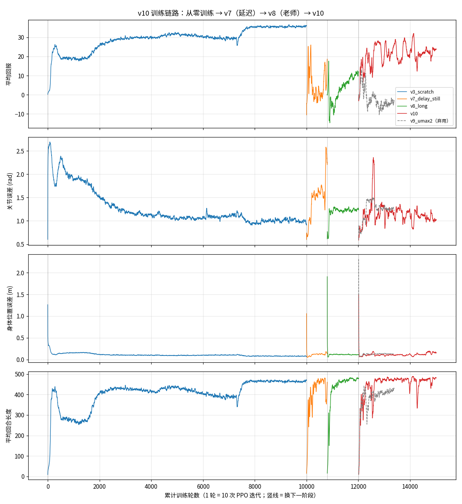

# G1 SuperMimic：跳舞 + 摔倒后照真人动作自动起身

在 Unitree G1（29 自由度）上，用一个 SuperMimic 全身动作追踪器完成三件事：照着 LAFAN1 真人动作撑地起身、站立、跳舞。
包括训练代码、仿真评测、真机部署代码、全部评测结果、训练曲线和踩坑记录。动作数据和权重受数据集许可约束，不在本仓库里，见下文「数据、权重和许可」。

最终版本是 **v10**（2026-11-26）。仿真里在四种地面上都能稳定起身；同一天在真机上测了 4 次（3 次仰卧、1 次俯卧），**4/4 成功**，每次约 11–12 秒站稳。

演示视频：[results/videos/demo_v10.mp4](results/videos/demo_v10.mp4)（5 种躺姿在 4 种地面起身 + 软垫上跳舞被推倒后起身）、[results/videos/stand_compare.mp4](results/videos/stand_compare.mp4)（站立抖动对比）。

## 结果（v10，仿真留出测试：新随机种子 + 每次新地形）

| | 硬地 | 软垫 | 不平地砖 | 不平 + 软 |
|---|---|---|---|---|
| 起身（5 种躺姿 × 6 次） | 30/30 | 30/30 | 27/30 | 29/30 |
| 起身后站稳（关节摆动 ≤ 5°） | 30/30 | 30/30 | 30/30 | 28/30 |
| 跳舞中被推倒后自己起来 | 18/18 | 18/18 | 18/18 | — |

* 不平地砖的 3 次"失败"其实都站着、摆动 3–4°，只是没达到"连续 2 秒不动"的严格标准。
* 跳舞（94 支舞 × 3 轮，平地）：成功率 99.74%，关节误差 0.73 rad。对比基线（我们 11-23 按作者默认配置训练的追踪器 `base`）：99.84%，0.66。
* 全部评测原始结果在 [results/eval](results/eval)，每个目录的 `summary.txt` 是汇总。

训练曲线（从零训练 → v7 → v8 → v10，灰色虚线是弃用的 v9）：



## 方案

```
躺着/摔倒 ──► SETTLE：小 PPO 策略把身体调整到起身动作的第一帧
             └─ 到位后改为 PD 保持该姿势（软垫上策略会一直晃，不加这一步会超时）
          ──► TRACK：SuperMimic 追踪器跟踪 LAFAN 起身动作（俯卧 / 仰卧两套）
          ──► 站立：保持 LAFAN 俯卧起身动作的最后一帧姿势
             （BONES 的站姿在软垫上会抖 16°，换成这个后约 4°）
          ──► 跳舞：同一个追踪器跟踪舞蹈动作；摔倒检测 → 回到 SETTLE
失败（调整卡住 / 起身跟丢）：换另一套起身路线重试，最多 4 次，之后进入阻尼
```

* 起身动作：LAFAN1 `fallAndGetUp2_subject2`，俯卧 28.0–35.0 s、仰卧 12.0–18.6 s，两段都是手撑地、比较慢的起身。
* 追踪器训练加的东西（相对作者配置）：软/硬地面随机（35% 硬地）、不平地面（45% 平地，其余 1–2.5 cm 起伏）、摩擦/PD 增益/电机强度随机、电机转矩-转速曲线、**0–20 ms 控制延迟**（站立抖动的主要原因）、站立时的关节速度惩罚、用基线追踪器做行为克隆老师。

## 目录

| 路径 | 内容 |
|---|---|
| [training/tools](training/tools) | 数据转换、打包、追踪器训练/微调、导出、评测脚本 |
| [training/tools/robust_task.py](training/tools/robust_task.py) | 加了地面/延迟/防抖的训练任务 `SuperMimic-GenCoord-G1-Robust` |
| [training/getup/g1getup](training/getup/g1getup) | SETTLE 策略的训练任务 `G1-Settle`（mjlab + RSL-RL PPO） |
| [deploy](deploy) | 部署代码：`unified.py`（状态机）、`run_g1.py`（真机/仿真启动器）、`sim2sim.py`（CPU MuJoCo 评测）、渲染脚本 |
| [results](results) | 全部评测结果、演示视频 |
| [reports](reports) | 早期阶段（11-23 到 11-24）的报告、视频、真机日志 |
| [docs/TRAINING.md](docs/TRAINING.md) | **复现步骤**：每一步的完整命令和版本历史 |
| [docs/PITFALLS.md](docs/PITFALLS.md) | **踩坑记录**：25 个坑，每个写了现象、原因、怎么解决 |
| [results/training_curves](results/training_curves) | 每次训练的逐轮指标（CSV）和 v10 链路的训练曲线图 |
| [docs/README_earlier_stages.md](docs/README_earlier_stages.md) | 早期方案（v3 PPO 起身 + 每支舞一个 ONNX）的说明 |

## 真机部署（只测起身）

```bash
# 机器人上，起身程序目录（真机测试用的是 ~/supermimic_getup_v10_20261126）
bash start_getup.sh        # 启动后先是阻尼状态
# 遥控器 START / A = 开始起身；L2+B 或 R2 = 阻尼急停
bash stop_getup.sh         # 停止并把控制交还给宇树的 ai 服务
```

注意：
* 宇树自带的 `ai` 服务可能不响应阻尼请求（返回 3102）。启动器只有在读到身体倾角 ≥ 60°（躺着）时才会释放它，站着的机器人会拒绝接管。
* 启动器依赖 `unitree_sdk2py` 和 `onnxruntime`，`start_getup.sh` 里的 `PYTHONPATH` 要改成你机器上的路径。

## 数据、权重和许可

本仓库**不包含**任何动作数据和训练好的权重：

* **BONES-SEED**（[bones-studio/seed](https://huggingface.co/datasets/bones-studio/seed)）：使用自定义许可（BONES-SEED License），需要在 Hugging Face 上同意条款后才能下载。训练用的 `pack_main` / `pack_v3`，以及 `deploy/motions/` 里的 3 支测试舞蹈和 `getup_supine.npz`，都是从它转换出来的。
* **LAFAN1**：CC BY-NC-ND 4.0，不允许分发改编后的版本。起身动作 `lafan_prone/supine.npz` 是从它切出来并重定向到 G1 的。
* **权重**是用以上数据训练的，能否公开还没有确认，所以也没有放进来。

自己生成数据：

1. 在 Hugging Face 同意 BONES-SEED 的条款，下载 `g1.tar.gz` 和 metadata。
2. 获取 LAFAN1 的 G1 重定向 CSV（`fallAndGetUp*`）。
3. 按 [docs/TRAINING.md](docs/TRAINING.md) 第 1 步运行 `convert_bones.py` → `filter_bones.py` → `fix_and_pack.py`，以及 `convert_lafan.py` → `make_lafan_getups.py`。
4. 部署时把 `lafan_prone.npz`、`lafan_supine.npz` 放到 `deploy/motions/`。测试舞蹈可以用 `convert_bones.py` 从 BONES-SEED 转换对应片段（片段名见 `deploy/motions/` 的引用和评测结果）。

依赖：[HybridRobotics/supermimic](https://github.com/HybridRobotics/supermimic) `5fb9229`、[HybridRobotics/mjlab_research](https://github.com/HybridRobotics/mjlab_research) `379c55e`（两者都没有修改，我们的改动都在 `training/tools` 里），Apache-2.0。
